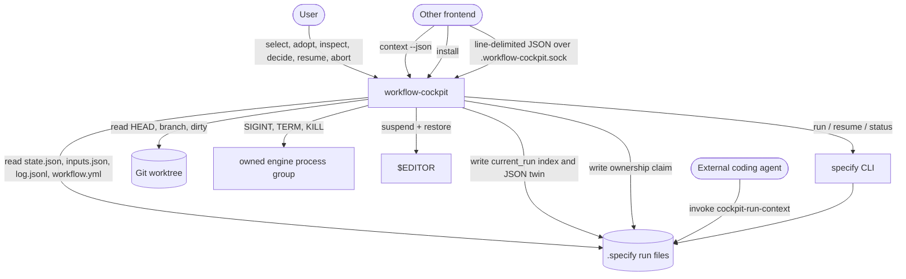

# 3. Context and Scope

| Field | Value |
|---|---|
| arc42 | 3. Context and Scope |
| Tier | 2 |

## Business context

The Cockpit sits between a user's terminal and an already initialized Spec Kit project. It shows
one run and owns that run's lifecycle; the workflow engine remains the only thing that actually
advances a workflow. It starts a new run, discovers and adopts an existing paused or failed run, or
inspects an existing run read-only under `.specify/workflows/runs/`.

The engine is never modified. Cockpit's only writes inside `.specify/` are the stable context index
at `.specify/workflows/runs/current_run` and its JSON twin `current_run.json`, which point at the
authoritative sources instead of copying them, and the Cockpit-owned ownership claim
`runs/<run_id>/.cockpit-owner.json`, held for every run Cockpit starts or adopts; lifecycle state
changes only through `specify workflow resume`. The headless host adds one artifact outside
`.specify/`: the gitignored socket `.workflow-cockpit.sock` at the worktree root.

## Technical context

| Neighbor | Interface | Direction |
|---|---|---|
| `specify` CLI | `workflow run`, `workflow resume`, capability probes; argv without a shell | write |
| Persisted run files | `state.json`, `inputs.json`, `log.jsonl`, `workflow.yml` | read |
| Run directories | bounded discovery of `.specify/workflows/runs/` and the `current_run` index | read |
| Ownership claim | `runs/<run_id>/.cockpit-owner.json` (owner identity plus liveness evidence) | write |
| Workflow catalog | `.specify/workflows/workflow-registry.json` | read |
| Git | `HEAD`, branch, dirty state via `GitService` | read |
| Engine process group | signals only while the owned child is verified live | signal |
| `$EDITOR` | suspend/restore Textual while paused at a gate | interactive |
| External agent | `cockpit-run-context` skill reads the context index only | read |
| Other frontends | `context --json` envelope, `install`, and the host socket | read/write |
| Host socket | `.workflow-cockpit.sock` at the worktree root (gitignored) | read/write |

## External interfaces

- **Launch:** `workflow-cockpit [--project PATH]`; discovers the nearest Spec Kit project root. The
  default surface is the Textual cockpit; `context`, `install`, and `serve` are subcommands of the
  same entry point, sharing `--project`/`--specify`.
- **Read command:** `workflow-cockpit context --json [--file RELATIVE_PATH]` prints exactly one
  versioned JSON envelope (the file view) on stdout and nothing else; diagnostics go to stderr. It
  exits 0 whenever an envelope is produced — including no run and any source condition — and 2 only
  for no discoverable project or invalid arguments (a `--file` outside the Feature Files index or
  escaping the project). It is read-only: no writes, no claim, no signals.
- **Install command:** `workflow-cockpit install` installs every artifact registered for the
  project's integration and prints one `<outcome> <relative-path> [reason]` line per artifact. It
  exits 0 even when an individual artifact fails, and 2 only when no project is found. The TUI
  start path runs the same installer, non-fatally.
- **Host command:** `workflow-cockpit serve` detaches a headless host that owns one run over the
  line-delimited JSON socket at the worktree root; a second host is refused with
  `host_already_running`. `serve` is POSIX-only: Unix domain sockets and process groups are the
  mechanism, so native Windows is out of scope for it (`context` and `install` stay portable).
- **Compatibility:** one resolved `specify` executable in the tested range (`>=1.0,<2.0`); refused
  outside it with install guidance.
- **Context index:** a Markdown index (not a snapshot) listing authoritative live sources for a
  user-chosen external agent, plus the `current_run.json` pointer twin for programs. Both carry the
  same run identity; a reader that finds them disagreeing reports the disagreement instead of
  guessing.
- **Skill:** `cockpit-run-context` consumes only the context-index path and never invokes workflow
  lifecycle commands. It stays inside the worktree: process liveness is read with `ps`, never
  `/proc`, so it triggers no out-of-project permission prompt.
- **Adoption, inspection, and deletion:** the launch screen lists bounded, read-only run descriptors.
  An adoptable `paused` run can be claimed and decided and an adoptable `failed` run claimed and
  resumed once from its recorded step; any usable run (including `running`, terminal, or
  foreign-owned) can be inspected read-only without acquiring a claim or spawning processes; and a
  confirmed user action may delete one stale run directory under the safety rules in
  [ADR 0011](../decisions/0011-delete-run-directories.md).

## Engine contract

Recorded against `specify 1.0.6.dev0` and applied to every build that passes the range check and
workflow capability probe; every row is covered by a Cockpit test or a code reference.

- **Version.** `specify --version` prints `specify <pep440>`. Tested range `>=1.0,<2.0`; prereleases
  in range are accepted, `0.16.1` and `2.0.0` are refused. Probes are non-mutating:
  `specify workflow --help` lists `run resume status list`, and `specify workflow run --help`
  lists `--input/-i` and `--json`.
- **Launch.** `specify workflow run <workflow_id> -i <name>=<value> ...` with **no shell**. `-i`
  values are strings the engine coerces. cwd is the selected canonical project root and
  `SPECIFY_INIT_DIR` is set to it on every child. `SPECKIT_WORKFLOW_RUN_ID` is used verbatim.
- **Run files.** `runs/<run_id>/` contains `workflow.yml` (written first), then atomic
  `state.json`/`inputs.json` (temp file + `os.replace`) and append-only `log.jsonl`. Cockpit
  refuses to spawn when the run directory already exists.
- **Run-file bounds.** Every read of `state.json` is bounded by one shared constant,
  `MAX_STATE_BYTES` = 4 MiB (`workflow_cockpit/services/limits.py`), in both run discovery and the
  live reader. Above it the run is reported "state.json too large" and never read unbounded; the
  log tail keeps its separate 256 KiB window. A composed run's `state.json` embeds one frozen
  definition per bound call and retains each step's output after completion, which is why the bound
  is above the old 256 KiB discovery limit. The read command reuses these bounds and reports each
  truncation: the Feature Files index is capped at `MAX_FEATURE_FILES`, a single-file read is capped
  at the UI's preview limit, and the pointer pair is capped at 64 KiB.
- **Execution tree.** From `specify 1.1.3`, `state.json` also carries `execution` (version 2): the
  persisted tree of the root and called scopes, with a YAML `source` string zipped against a
  parallel `nodes` list of `phase`/`active`/`result`/`outcome` records, and one frozen definition
  per bound `type: workflow` call. Cockpit reads it as a persisted structure
  ([ADR 0015](../decisions/0015-read-the-persisted-execution-tree.md)): only version 2 is
  interpreted, an absent `execution` is a legacy run, and the active node is the engine's first
  unfinished node in a children-first walk — never the per-node `active` marker, which every
  entered node carries. `log.jsonl` events from a called scope add `workflow_id` and an index-based
  `execution_path`; Cockpit treats the path as an opaque tuple key, so scopes never merge. Cockpit
  never imports the engine: the reading is re-verified by a gated contract test that diffs it
  against the engine's own `status --json`.
- **Gates.** `verdict_input` gates resume with `resume -i <name>=<choice> --json`; gates without it
  are answered by one write to the managed PTY. The recorded prompt contract applies to any
  supported engine, so interactive gates are not restricted to a single release. The engine exposes
  no abort command, so Abort uses signals. A gate inside a called scope is taken from the active
  node of the execution tree, and its `verdict_input` is traced through every call's `input:`
  mapping to the root input name the engine accepts, so the submission is always one
  `resume -i <root_input>=<choice>`.

Out of scope: workflow authoring/installation, built-in multi-run history, multi-run dashboards,
automatic run cleanup or archiving, launching or editing workflow definitions, adopting `running`
runs, taking over a run held by another live process, hosted services, launching or managing coding
agents, notifications, localization, and native Windows. Deleting a stale run is an explicit,
confirmed capability, not automatic history management. The headless host is POSIX-only (Unix
domain sockets and process groups); the read and install commands stay portable.
